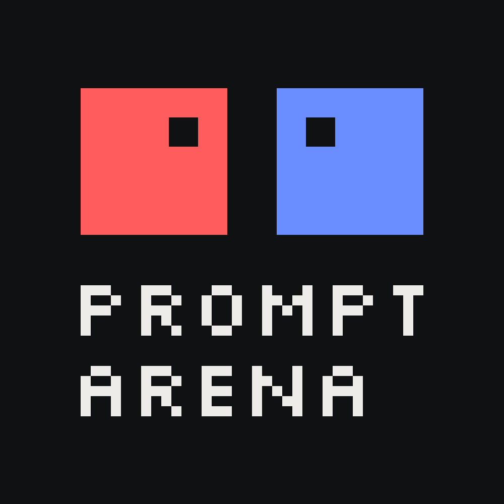
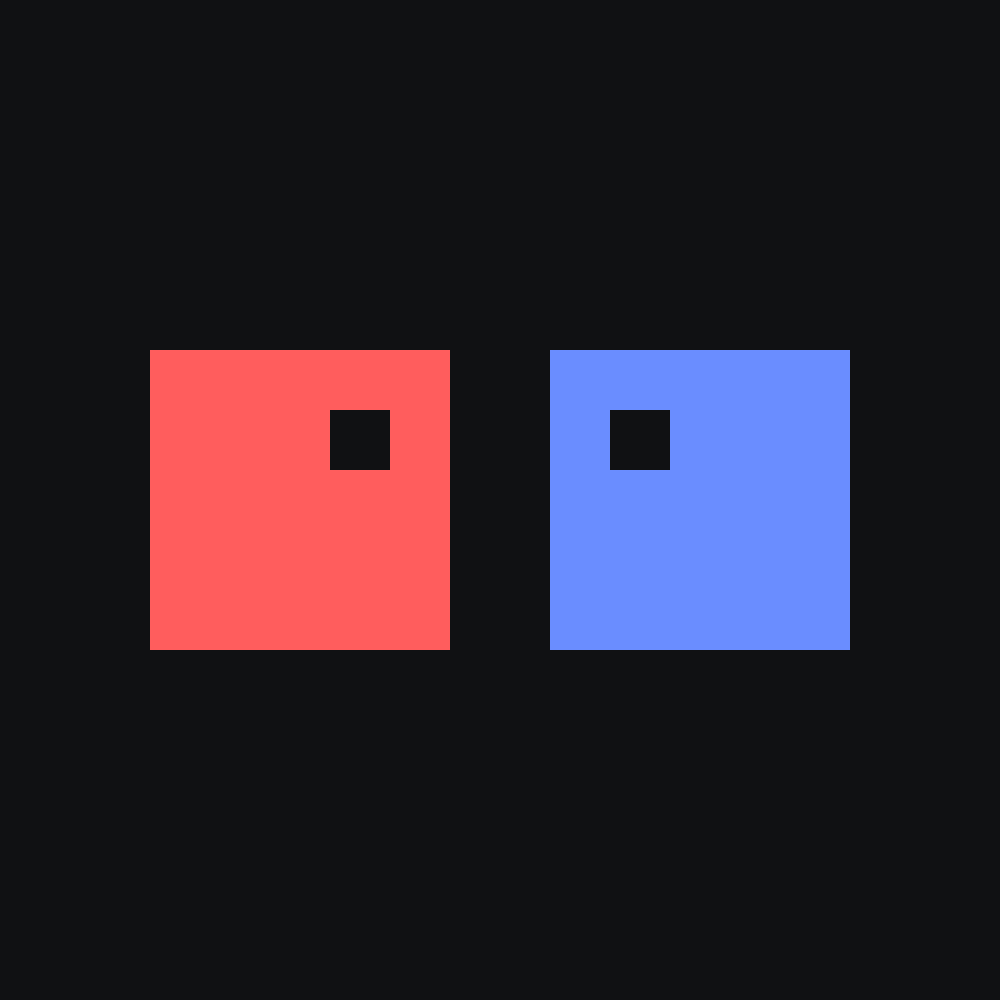

# Marca de Prompt Arena

La marca sale de lo que ya estaba en la barra del sitio: dos cuadrados, uno rojo y uno azul. Son los dos agentes, frente a frente. Todo lo demás se construye sobre la misma grilla de píxeles.

Las piezas se generan con `python3 scripts/marca.py` y quedan en `apps/web/public/brand/`. No se editan a mano.

La guía completa, para compartir fuera del repo, está en PDF: [marca/Prompt-Arena-guia-de-marca.pdf](marca/Prompt-Arena-guia-de-marca.pdf) (9 páginas). Se arma con `python3 scripts/marca_guia.py`, que escribe `marca/guia-de-marca.html`; el PDF es esa página impresa desde un navegador, en A4 apaisado, sin márgenes y con los gráficos de fondo.

## Logo

Es el logo principal y el de la entrega (`project-logo.png` es este mismo, en PNG de 1000 × 1000). El isotipo mide lo mismo de ancho que la palabra "PROMPT".

## Isotipo

- Cada cuadrado es una grilla de 5 × 5 píxeles. La separación entre los dos es un tercio del lado.
- Cada cuadrado tiene un píxel vacío en la segunda fila, del lado del rival: los dos agentes se miran. El píxel es un hueco de verdad, así que deja ver el fondo que haya detrás.
- El rojo va siempre a la izquierda y el azul a la derecha, igual que en el marcador de la pelea.

## Qué pieza usar

| Pieza | Archivo | Cuándo |
|---|---|---|
| Logo | `logo.svg` | Portadas, la página de votación, redes. |
| Ícono | `icono.svg` | Avatares e íconos de 48 px o más. |
| Ícono simple | `icono-simple.svg` | Favicon y todo lo que mida menos de 48 px: sin las miradas, que a ese tamaño no se distinguen. |
| Horizontal | `horizontal.svg` | Encabezados sobre fondo oscuro. |
| Horizontal claro | `horizontal-claro.svg` | Encabezados sobre fondo claro. |
| Isotipo | `isotipo.svg`, `isotipo-simple.svg` | El isotipo solo, sin fondo. |
| Nombre | `nombre.svg` | El nombre solo, sobre fondo oscuro. |

Además, en `apps/web/public/` hay PNG sacados de esos SVG, para lo que no lee SVG:

| Archivo | Sale de | Para qué |
|---|---|---|
| `og.png` (1200 × 630) | `brand/og.svg` | La tarjeta que aparece al compartir un enlace del sitio. |
| `apple-touch-icon.png` (180) | `brand/icono.svg` | El ícono al agregar el sitio a la pantalla de inicio de un teléfono. |
| `icon-192.png`, `icon-512.png` | `brand/icono.svg` | Los íconos de `site.webmanifest`. |
| `favicon-32.png` | `brand/icono-simple.svg` | Favicon para navegadores que no leen SVG. |

Si cambia la marca, se vuelven a sacar abriendo cada SVG en un navegador al tamaño indicado. Los datos para buscadores y vistas previas de todas las páginas están en `apps/web/src/components/PageHead.astro`.

La barra del sitio usa el isotipo simple (dos cuadrados de 9 px) junto al nombre en Silkscreen.

## Colores

| Nombre | Valor | Uso |
|---|---|---|
| Rojo | `#ff5d5d` | El lado rojo. |
| Azul | `#6a8dff` | El lado azul. |
| Fondo | `#101113` | Fondo del sitio y del logo. |
| Texto | `#edece8` | Texto y el nombre sobre fondo oscuro. |
| Ámbar | `#e8b84a` | Lo que no es de ningún lado: el equipo, el modelo de referencia, los avisos. |

Rojo y azul solo significan "este lado". No se usan para decorar ni para marcar errores o enlaces.

## Tipografía

- **Silkscreen**, para el nombre y las etiquetas cortas. Es una fuente de píxeles de 8 px: se usa en múltiplos de 8 (16, 24, 32, 48). En los SVG el nombre va dibujado como rectángulos, para no depender de tener la fuente.
- **Instrument Sans**, para todo el texto.

## Reglas

- Esquinas rectas, sin sombras ni degradados. El logo no se redondea ni se inclina.
- Alrededor del logo queda libre, como mínimo, la separación entre los dos cuadrados.
- Los cuadrados no cambian de color, de orden ni de proporción, y no se les agregan más rasgos.
- Sobre una foto o un video, el logo va con su fondo (`logo.svg` o `icono.svg`), no el isotipo suelto.
